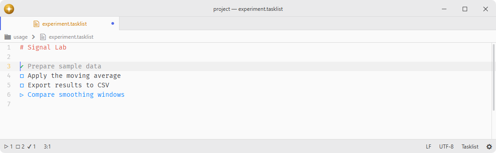
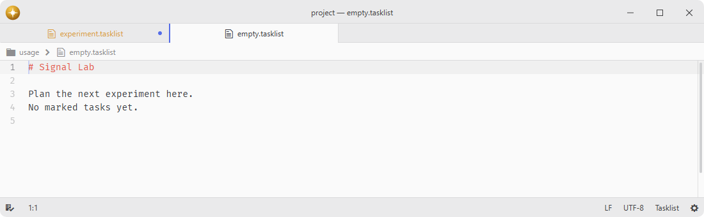

# tasklist-tools

Task state management and navigation commands for tasklist files.

Requires a grammar package such as [language-tasklist](https://github.com/lumine-code/language-tasklist).

## Features

- **Task toggling**: cycle through task states with keyboard or middle-click.
- **Quick state commands**: set tasks directly to high, todo, done, fail, or info.
- **Header navigation**: jump between headers or move items to headers.
- **Status bar counter**: shows nonzero task counts by type with click-to-navigate, a neutral checklist when no marked lines remain, and follows changes to the active editor's grammar.
- **Markdown translation**: convert markdown checkboxes to tasklist format.
- **Navigation panel**: outline support via [navigation-panel](https://github.com/lumine-code/navigation-panel).





## Installation

To install `tasklist-tools` search for it in the Install pane of the Lumine settings, or run the command `lumine --install lumine-code/tasklist-tools`.

## Commands

Commands available in `lumine-text-editor[data-grammar~="tasklist"]:not([mini]):not([readonly])`:

- `tasklist-tools:toggle-tick`: add or toggle tick of selected tasks by `▷` `☐` `•` -> `✔` -> `✘` -> `☐` cycle,
- `tasklist-tools:set-as-high`: add or change tick of selected tasks as `▷`,
- `tasklist-tools:set-as-todo`: add or change tick of selected tasks as `☐`,
- `tasklist-tools:set-as-done`: add or change tick of selected tasks as `✔`,
- `tasklist-tools:set-as-fail`: add or change tick of selected tasks as `✘`,
- `tasklist-tools:set-as-info`: add or change tick of selected tasks as `•`,
- `tasklist-tools:translate-markdown`: translate markdown-style ticks and bullets to tasklist-style,
- `tasklist-tools:move-items-to-next-header`: move selected items to next header,
- `tasklist-tools:move-items-to-last-header`: move selected items to last header.

Commands available in `lumine-text-editor[data-grammar~="tasklist"]:not([mini])`:

- `tasklist-tools:go-to-next-tick`: navigate to next tick of any type with wraparound,
- `tasklist-tools:go-to-next-high`: navigate to next `▷` tick with wraparound,
- `tasklist-tools:go-to-next-todo`: navigate to next `☐` tick with wraparound,
- `tasklist-tools:go-to-next-done`: navigate to next `✔` tick with wraparound,
- `tasklist-tools:go-to-next-fail`: navigate to next `✘` tick with wraparound,
- `tasklist-tools:go-to-next-info`: navigate to next `•` tick with wraparound,
- `tasklist-tools:move-to-next-header`: set cursor position equal to next header,
- `tasklist-tools:move-to-previous-header`: set cursor position equal to previous header,
- `tasklist-tools:move-to-last-header`: set cursor position equal to last header.

## Usage

Large-document commands prepare changes from immutable source chunks, keep the editor responsive and publish one undo step. Changing text or selection, switching grammar or deactivating the package cancels unfinished preparation. Task counters update from the affected rows after a single edit and use a cancellable chunked recount for other changes; counting never creates a document string or an array of every task.

## Customization

The status-bar counter can be restyled from your `styles.css`, e.g.:

```css
.tasklist-status {
  #done-counter {
    color: var(--text-color-success);
  }
  #fail-counter {
    color: var(--text-color-error);
  }
}
```

Left-click the status counter to go to the next task and middle-click to toggle its state in that counter's window. Right-click for both actions and menus for navigating by type or setting a state; these commands use the tasklist focused before opening the menu.

## Services

- `status-bar`: consumed to show the task summary counter in the status bar.

## Contributing

Got ideas to make this package better, found a bug, or want to help add new features? Just drop your thoughts on GitHub. Any feedback is welcome!
